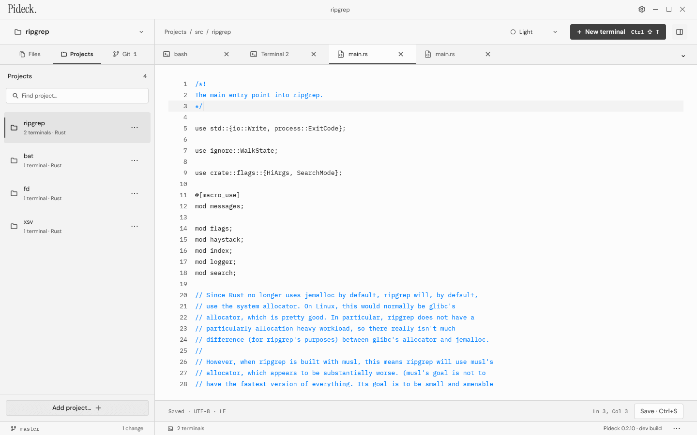
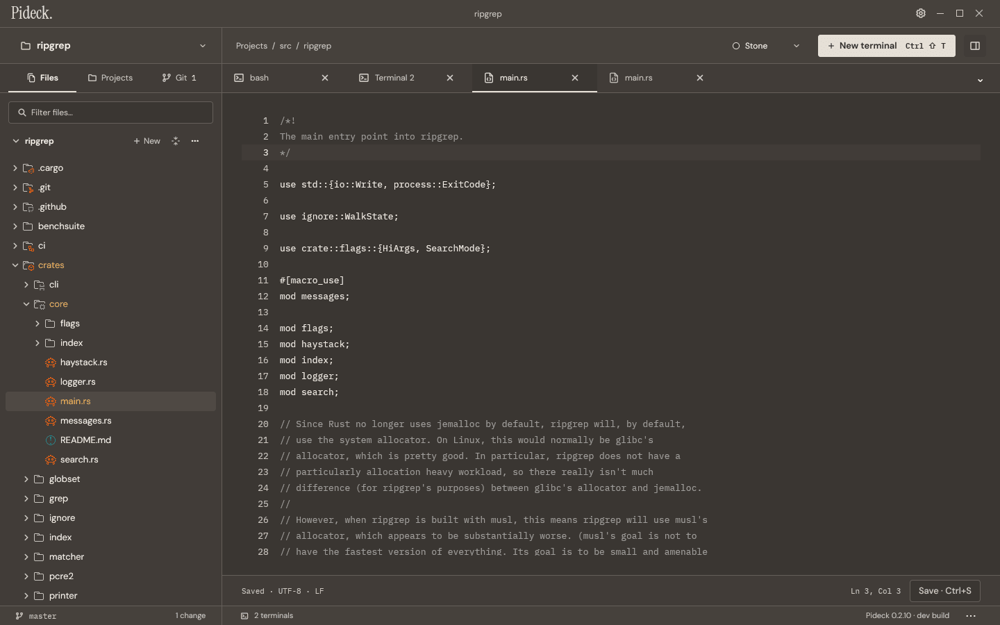
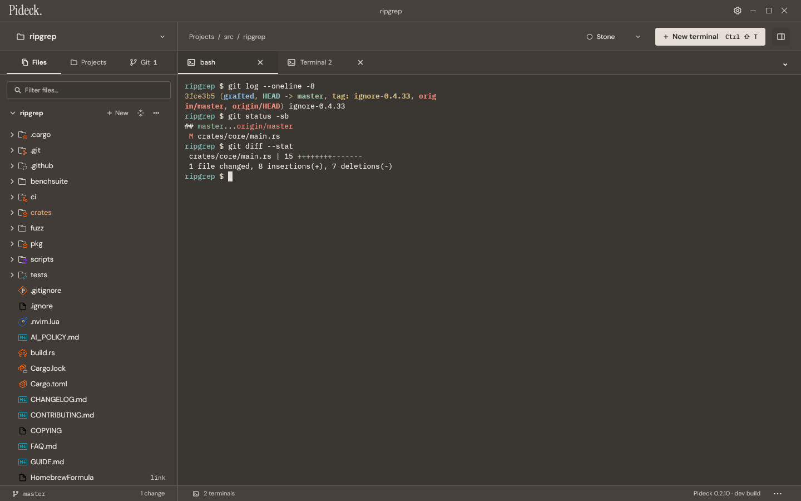
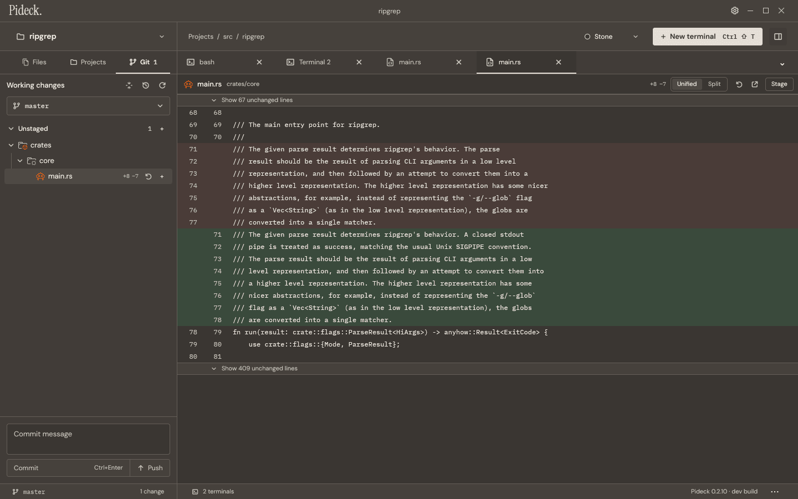
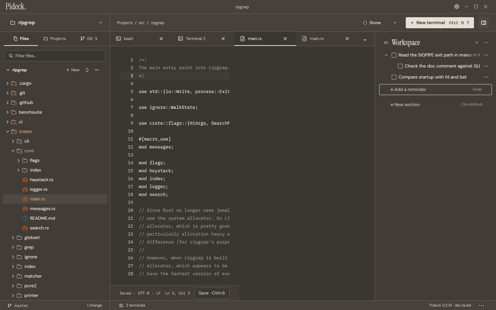

# Pideck

A native Windows workspace for files, Git, and terminals. Several project folders stay open at once, and each one keeps its own tree, review, reminders, and shells. Pideck is written in Rust with [GPUI 0.2.2](https://docs.rs/crate/gpui/0.2.2/source/).

Switch projects from the selector in the toolbar. The sidebar is **Files**, **Projects**, and **Git**. Editors, terminals, and read-only diffs share one tab strip.



These screenshots are from a development build. The folders are fresh clones of [ripgrep](https://github.com/BurntSushi/ripgrep), [bat](https://github.com/sharkdp/bat), [fd](https://github.com/sharkdp/fd), and [xsv](https://github.com/BurntSushi/xsv). The Git review is an uncommitted edit in that ripgrep clone.

## Install

**Windows installer.** Download [PiDeck Setup](https://github.com/dev4st3d/pideck/releases/latest) (`PiDeck-win-Setup.exe`). Installed copies check GitHub Releases on startup. Use **Check for updates** in the status bar’s **⋯** menu, then **Update and restart**.

**From source.** Use Windows with the stable Rust MSVC toolchain and the Windows SDK. The declared Rust syntax floor is 1.88.

```powershell
cargo run --locked
```

A release build:

```powershell
cargo build --release --locked
```

Pideck embeds DM Sans for interface text, Instrument Serif for the wordmark and reminder headings, and IBM Plex Mono for terminals, code, and counts. The terminal font can be changed in Settings. No font-preparation step, Node.js, or separate Pi install is required to build or launch. Programs you start inside a terminal have their own install requirements.

## A look around

### Projects

Add a folder with `Ctrl+Shift+O` or **Add project**. `Ctrl+Alt+Up` and `Ctrl+Alt+Down` move between projects. Each row menu holds that project's actions. Removing a project closes its terminals and deletes its saved checklist; files on disk stay where they are. Changed editor files go through their save flow first.

The project list, the file tree, and the Git tree have separate filters. File search stops at 20,000 visited entries and 2,000 matches, and it never follows directory links. An incomplete search says so. Filtering keeps matching ancestors. Clearing the Files or Git filter restores the previous expansion, selection, and scroll position.

### Files



Open a file from the tree, edit it, and choose **Save** or press `Ctrl+S`. A changed tab shows a dirty marker. Closing a changed file offers Save, Discard, or Cancel. Closing a project or the window offers **Save all and close**. A save checks for edits made outside Pideck and reports a conflict while keeping your buffer open.

The editor accepts UTF-8 text up to 2 MiB. PNG, JPEG, GIF, WebP, BMP, and TIFF open in a read-only viewer, up to 32 MiB or 50 megapixels. Each directory listing stops at 2,000 entries, and the sidebar says when a folder was cut short.

Click a row to select it. Double-click or Enter opens it. Ctrl-click toggles a multi-selection and Shift-click selects a range. Right-click for file operations, copying a path, hidden files, and reveal in Windows Explorer. New file and folder names are edited in the panel.

With the explorer focused: `Ctrl+C`, `Ctrl+X`, and `Ctrl+V` copy, cut, and paste; `Ctrl+A` selects the visible rows; `Ctrl+D` duplicates; `F2` renames; `Delete` asks before moving items to the Recycle Bin; `Ctrl+N` creates a file; `Ctrl+Shift+N` creates a folder. Drag inside the tree to move, and hold Ctrl to copy. Drops from outside Pideck, and pastes from the Windows file clipboard, copy into the selected folder. Cut stays inside Pideck. Existing destinations are left in place. An interrupted copy can leave a finished or partial destination, and the source is kept. Directory links are not copied recursively. A move across drives copies first.

The explorer and Git status refresh when the filesystem changes. `F5` refreshes manually.

### Terminals



Every terminal starts in its project's directory. Run `codex`, `claude`, or any other command after that program is installed on its own. Shells keep running when their tab or project is hidden. `` Ctrl+` `` or `Ctrl+Shift+T` opens another terminal, up to eight per project. `Ctrl+Shift+W` closes the active tab. `Ctrl+Tab` and `Ctrl+Shift+Tab` move along the strip.

Drag to select text, double-click a word, or triple-click a line. Hold Alt while dragging for a rectangle. When a program has captured the mouse, hold Shift to select text or to scroll history. Copy uses the selection, or the visible screen when nothing is selected. Unicode and IME composition, bracketed paste, application mouse input, and scrollback are supported.

With the terminal focused, `Tab` and `Shift+Tab` go to the running program, so `Shift+Tab` can cycle modes in Claude Code. Outside the terminal, `Shift+Tab` does not move focus. `Ctrl+Shift+Tab` still changes tabs, and `Shift+F6` moves to the previous control.

### Git



The Git sidebar is a directory tree with added and deleted line counts, including new text files. **+** stages a file and **−** unstages it. Undo asks before discarding: tracked files return to their staged version, and new files go to the Recycle Bin. The diff can also discard one text hunk. Changed files are read again before a discard is applied.

The commit box sits under the tree. **Commit** or `Ctrl+Enter` commits only what is staged, and a failed commit keeps the message. **Push** sends the reviewed branch and does not force. **Publish** asks which remote should receive a new branch. A failed push keeps the local commit. Fetch is there for reading remote changes. Merging and conflict resolution stay explicit Git operations. Commits use your configured hooks and signing.

Click the branch name, or press `B` with the Git panel focused, to pick a local branch. Tab and Enter confirm. Switching keeps Git's conflict checks. It does not force, stash, or fetch, and it does not run Git hooks. Save dirty editor buffers first.

**History** opens a compact, paginated commit list in the sidebar. Select a commit, then one of its changed files, to read that historical diff. The list marks HEAD, known unpushed commits, and the remote tip. **Details** shows commit metadata and, for a merge, the parent used for comparison. **Changed files** expands the file list. **Changes** returns to the working tree and keeps the commit draft. History is read-only.

Choose Unified or Split. `Alt+Up` and `Alt+Down` move between files. `F7` and `Shift+F7` move between hunks and wrap at either end of the file. `Alt+U` and `Alt+S` switch the layout. Long lines scroll inside the code, leaving line numbers and the split divider in place. Split panes scroll horizontally together. `Shift+wheel`, `Ctrl+Shift+Left`, and `Ctrl+Shift+Right` pan. `F5` refreshes the open diff.

### Reminders



The checklist button in the toolbar, or `Ctrl+Shift+L`, opens the right inspector. Headings use Instrument Serif. Each project has its own reminders. Edits and collapsed branches are saved with the workspace. A new project starts with an empty Workspace section.

**Add a reminder**, type, and press Enter. The adjacent **+** creates a section. A reminder menu has **Add subtask**, **Rename**, and **Delete**. A section menu has **Rename** and **Delete**. Indent and outdent stay on the keyboard. Completing a parent completes its children, and a parent's checkbox and count follow those children. Deleting a subtree or section offers **Undo**, and `Ctrl+Z` restores recent edits while the checklist is focused. Removing a project removes its checklist; the removal prompt says so.

With the checklist focused: arrows move and fold, Space checks, Enter adds a reminder, `Ctrl+Enter` adds a subtask, `Tab` indents, `Ctrl+[` outdents, `F2` renames, `Delete` removes, and `Ctrl+Shift+N` creates a section. Escape cancels editing. `` Ctrl+` `` returns to the terminal. A long label shows its full text in a tooltip.

On a compact window, opening the inspector hides the left sidebar for that moment and remembers whether you wanted the sidebar. Below 720 logical pixels the inspector hides as well.

Drag the sidebar divider between 256 and 420 logical pixels. With the divider focused, Left and Right resize it and Home resets it. The default is 288 pixels, and 256 in a compact window. Files, Projects, and Git share that width.

## Keyboard

| Action | Keys |
|---|---|
| Add project folder | `Ctrl+Shift+O` |
| New terminal | `` Ctrl+` `` or `Ctrl+Shift+T` |
| Close active tab | `Ctrl+Shift+W` |
| Next / previous tab | `Ctrl+Tab` / `Ctrl+Shift+Tab` |
| Previous / next file (diff focus) | `Alt+Up` / `Alt+Down` |
| Previous / next hunk (diff focus) | `Shift+F7` / `F7` |
| Unified / split diff (diff focus) | `Alt+U` / `Alt+S` |
| Pan diff horizontally | `Shift+wheel` / `Ctrl+Shift+Left` / `Ctrl+Shift+Right` |
| Refresh selected diff | `F5` |
| Commit staged changes (commit box) | `Ctrl+Enter` |
| Save active file | `Ctrl+S` |
| Previous / next project | `Ctrl+Alt+Up` / `Ctrl+Alt+Down` |
| Toggle project sidebar | `Ctrl+Shift+B` |
| Toggle project checklist | `Ctrl+Shift+L` |
| Focus project sidebar | `F6` |
| Previous focus | `Shift+F6` |
| Copy terminal selection or visible screen | `Ctrl+Shift+C` |
| Select all terminal history | `Ctrl+Shift+A` |
| Paste into terminal | `Ctrl+Shift+V` |
| Scroll terminal history up / down | `Shift+PageUp` / `Shift+PageDown` |
| Open settings | `Ctrl+,` |

Projects, terminal tabs, the sidebar, reminders, Save, terminal copy/paste/select-all, and Settings can be changed in **Settings**. Explorer keys, diff keys, checklist keys, `Shift+F6`, and the terminal scrolling keys stay fixed.

## Settings

Open **Settings** from the gear in the title bar, the status bar’s **⋯** menu, or `Ctrl+,`. Esc, **Done**, or a click outside closes it and returns focus to the terminal.

**Terminal** chooses the font, size (9–24 px), and line height (1.0–1.8×) from IBM Plex Mono and the fixed-width families installed on the PC. The change applies to every open terminal immediately and resizes its grid and PTY. A preview shows ambiguous glyphs such as `0O` and `1lI`. If a saved font is later uninstalled, terminals use IBM Plex Mono and say so. The saved choice is kept until you change a setting. Other text keeps its design fonts.

**Keyboard** lists each rebindable shortcut. Up and Down select a row, Enter or **Change** records the next chord, and Delete or **Reset** restores the default. Esc cancels recording. A chord must include Ctrl, Alt, or Win, or be a function key. Esc, Tab, `Shift+F6`, `Alt+F4`, and plain Ctrl+letter are reserved for terminal programs and text editing. Save may use other Ctrl+letter chords. A chord already used by another shortcut is refused, and the message names that shortcut. A new chord replaces every default for that action, so **New terminal** stops answering to `` Ctrl+` `` as well as `Ctrl+Shift+T`.

Font and shortcut choices are stored as `terminal-font.json` and `keybindings.json` beside the settings file, normally under `%APPDATA%\Pideck`. A file that cannot be read is left untouched, and defaults are used until you change a setting. Delete the file to start over.

## Appearance

The theme picker sits beside **New terminal**. Tab, the arrow keys, Enter, and Escape operate it. A change applies to open files, diffs, and terminals without restarting shells or clearing their history.

| Theme | Character |
|---|---|
| Black | Near-black surfaces |
| Light | Neutral white surfaces |
| Graphite | Dark gray surfaces |
| Charcoal | Softer charcoal surfaces |
| Flint | Warm dark, a step below Stone |
| Stone | Warm, lifted dark. This is the default |
| Slate | Cool blue-gray, with a muted steel-blue accent |
| Moss | Green-black, with a sage accent |
| Kiln | Warm dark, with a terracotta accent |
| Iris | Indigo-black, with a lavender accent |

The choice is stored in `appearance.json` beside the workspace layout. A file that cannot be read is preserved until you explicitly choose a theme.

## Updates

Installed copies ask before an update restarts the app. Pideck asks about unsaved files and about stopping running terminals, then saves the workspace layout. Cancelling leaves the app open. A downloaded update can be applied later with **Restart to update**. A file or layout save that fails has to be resolved before the update can restart the app. The new process starts fresh shells. It does not resume commands or terminal history.

Source builds and unpackaged executables do not update from inside the app. Downloading an update does not apply it on the next launch by itself. Restarting to apply it is an explicit action.

## What is saved

While the app stays open, each project keeps its sidebar selection, expanded directories and scroll position, open file buffers and cursor positions, active tab, and terminal sessions. Switching projects reuses those views and processes.

Across restarts, Pideck restores project folders, the terminal layout, the selected terminal and project, sidebar visibility, the chosen sidebar width, project checklists, and whether the checklist was open. That data lives in `terminal-workspace.json` next to the settings file, normally under `%APPDATA%\Pideck`. `PI_GUI_SETTINGS_PATH` moves the settings file and the layout file beside it.

A restart creates new shells. Open files, buffers, cursor positions, expanded directories, terminal output, running processes, and CLI conversations are not read back from disk. Save files before closing, and use each CLI's own session feature when it has one.

If a saved layout cannot be read or restored, automatic saving pauses so the file is kept. Repair it and reopen the app, or choose **Replace saved layout** to store the current workspace instead. Closing without that choice keeps the previous file.

## Privacy

Workspace settings stay on the machine. Pideck adds no telemetry, analytics, or remote reporting. Commands you run have their own network and privacy behavior.

## Development

Rendering uses [GPUI 0.2.2](https://docs.rs/crate/gpui/0.2.2/source/). The editor uses [GPUI Component 0.5.1](https://docs.rs/crate/gpui-component/0.5.1/source/). Terminals use [Alacritty Terminal 0.26.0](https://docs.rs/crate/alacritty_terminal/0.26.0/source/) and `portable-pty`. GPUI Component brings in Zed's [sum-tree 0.2.0](https://docs.rs/crate/zed-sum-tree/0.2.0/source/) transitively. Those crates are Apache-2.0. No GPL-licensed Zed editor source was copied for this integration.

Finish an implementation before the final checks:

```powershell
cargo fmt --all -- --check
cargo check --all-targets
cargo test --all-targets
```

Contributor rules are in [AGENTS.md](AGENTS.md). The neutral theme direction is in the [design handoff](design/pideck-reimagined/README.md).

## License

[MIT](LICENSE).
