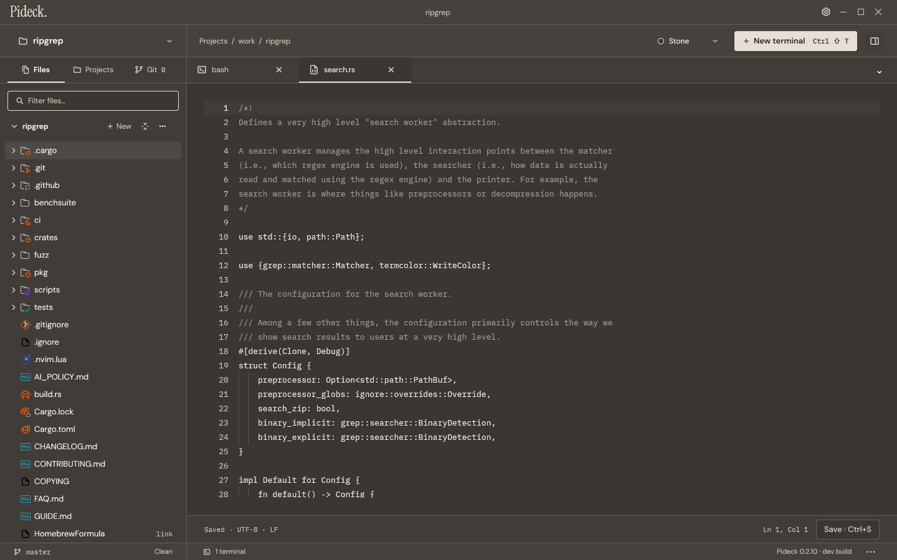
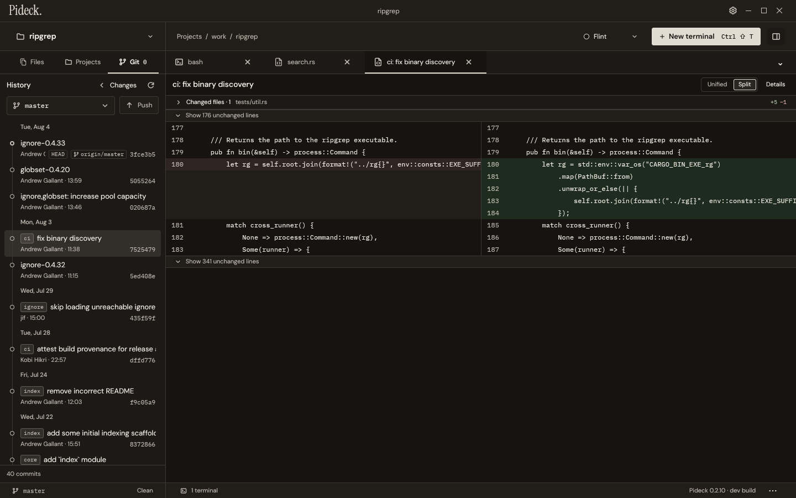
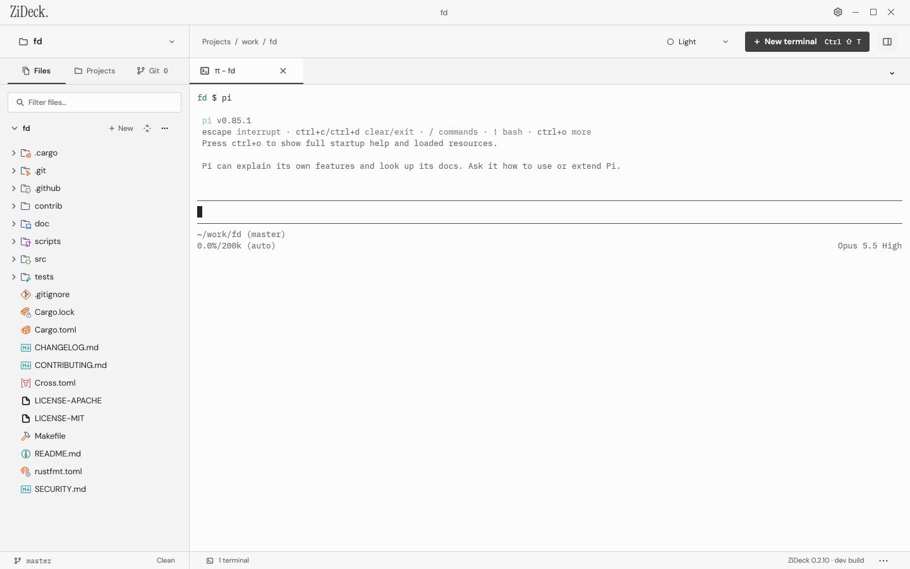

# Pideck

A native workspace for project folders, files, Git, and terminals. Rust and GPUI, for Windows.



Stone is the default. Flint and Light are below.





## What you get

- Several project folders. Each keeps its own files, Git state, and terminals.
- Text editing, image viewing, and diffs in one tab strip.
- Stage, commit, push, and history, including unified and split diffs.
- Terminals start in the project directory and keep running when you switch tabs or projects.
- A checklist for each project. Main shortcuts can be changed in Settings.

The theme, font, shortcuts, and layout stay on your machine. Pideck does not send telemetry.

## Run

Windows, stable Rust (syntax floor 1.88):

```powershell
cargo run --locked
```

```powershell
cargo build --release --locked
```

**PiDeck Setup** can check GitHub Releases. Applying an update restarts only after you confirm.

## Shortcuts

| Action | Keys |
| --- | --- |
| Add a project | `Ctrl+Shift+O` |
| New terminal | `` Ctrl+` `` |
| Close the active tab | `Ctrl+Shift+W` |
| Next / previous tab | `Ctrl+Tab` / `Ctrl+Shift+Tab` |
| Save the active file | `Ctrl+S` |
| Show or hide the sidebar | `Ctrl+Shift+B` |
| Show or hide the checklist | `Ctrl+Shift+L` |
| Settings | `Ctrl+,` |
| Copy / paste in the terminal | `Ctrl+Shift+C` / `Ctrl+Shift+V` |

Settings can replace these. Explorer, diff, and checklist keys stay fixed.

## Themes

Black, Light, Graphite, Charcoal, Flint, Stone, Slate, Moss, Kiln, and Iris. Pick one beside **New terminal**. Open files, diffs, and terminals update immediately.

MIT
